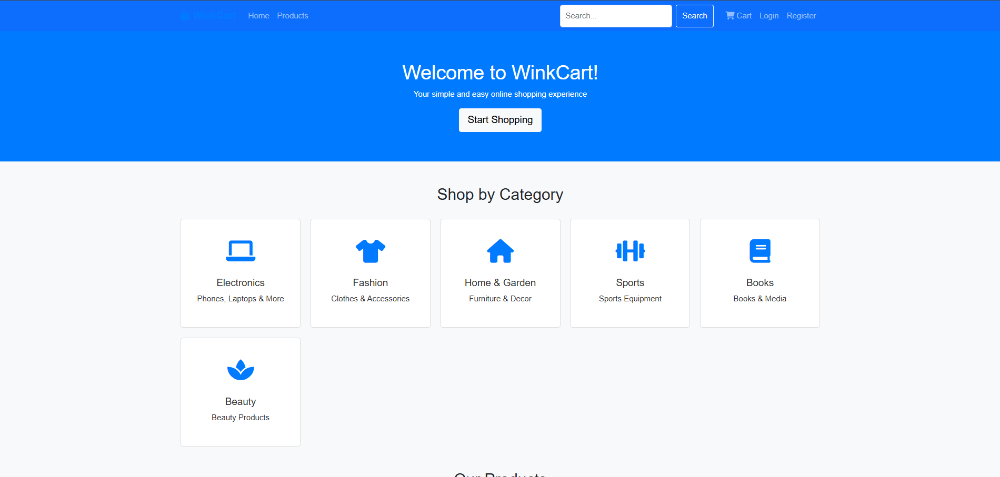
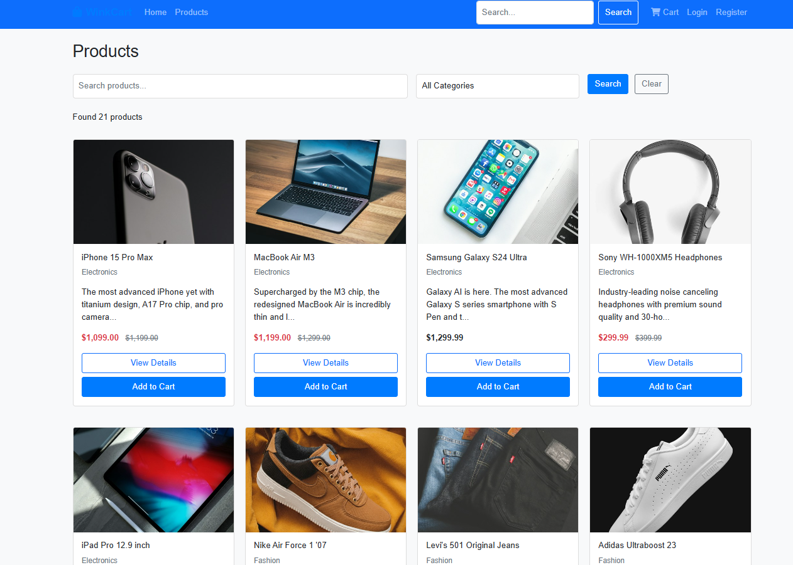
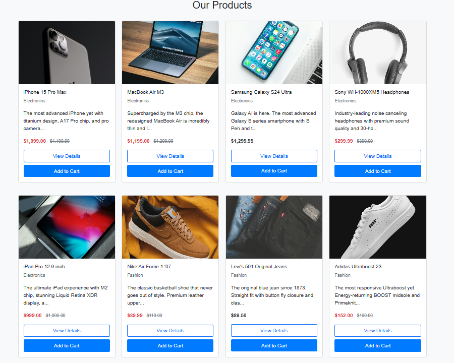
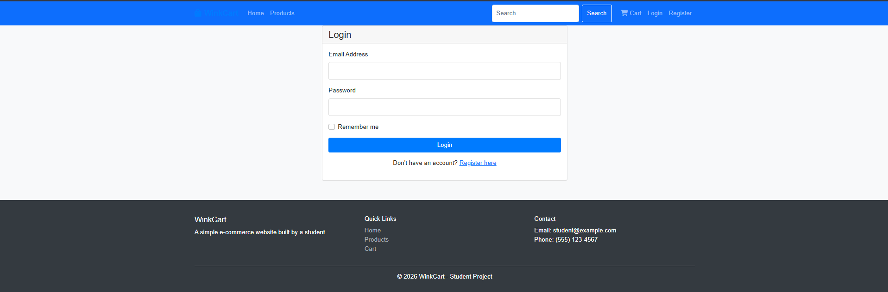
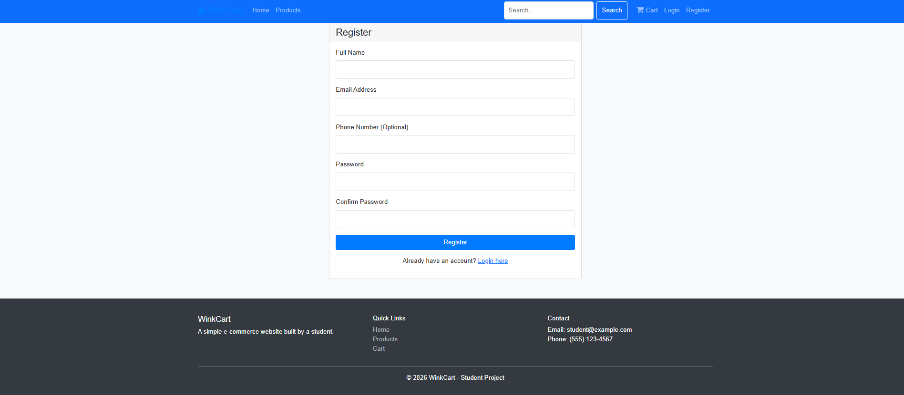
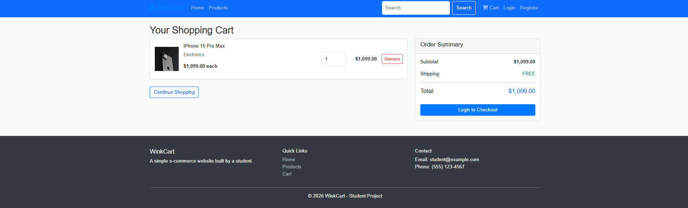

# WinkCart

WinkCart is a simple Laravel e-commerce project designed for learning and demonstration. It includes product browsing, a shopping cart, user authentication, and a basic admin experience.

## Features

- Modern storefront with featured categories and products
- Product search and filtering by category
- Shopping cart with add, update, and remove actions
- Login and registration flow
- Admin dashboard for viewing key store data
- Responsive design for desktop and mobile screens

## Tech Stack

- PHP 8.2+
- Laravel 12
- Bootstrap 5
- SQLite for local development
- Blade templating

## Screenshots

### Home page


### Product catalog


### Homepage products view


### Login page


### Registration page


### Cart page


## Installation

1. Clone the project
2. Open a terminal in the project folder
3. Run:

```bash
composer install
cp .env.example .env
php artisan key:generate
php artisan migrate
php artisan db:seed
php artisan serve
```

4. Open your browser at:

```text
http://127.0.0.1:8000
```

## Default Login Credentials

### Admin
- Email: admin@winkcart.com
- Password: password

### Customer
- Email: customer@winkcart.com
- Password: password

## Project Structure

- `app/` — application logic, controllers, and models
- `database/` — migrations and seeders
- `resources/views/` — Blade templates
- `routes/` — application routes
- `public/` — public web assets
- `tests/` — test suite

## Usage

- Browse products from the landing page
- Search or filter by category
- Add items to the cart and review them
- Log in or register to place an order
- Use the admin routes to access store management functions

## Notes

This project is intentionally simple and beginner-friendly, making it suitable for learning Laravel fundamentals such as routing, blade views, models, migrations, and session-based cart behavior.

## License

This project is open for learning and educational use.
